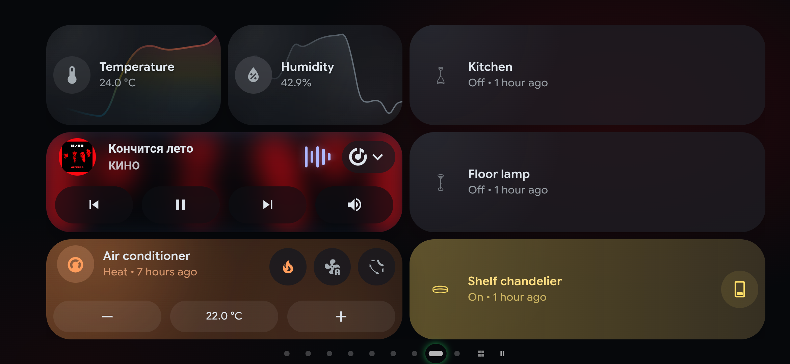
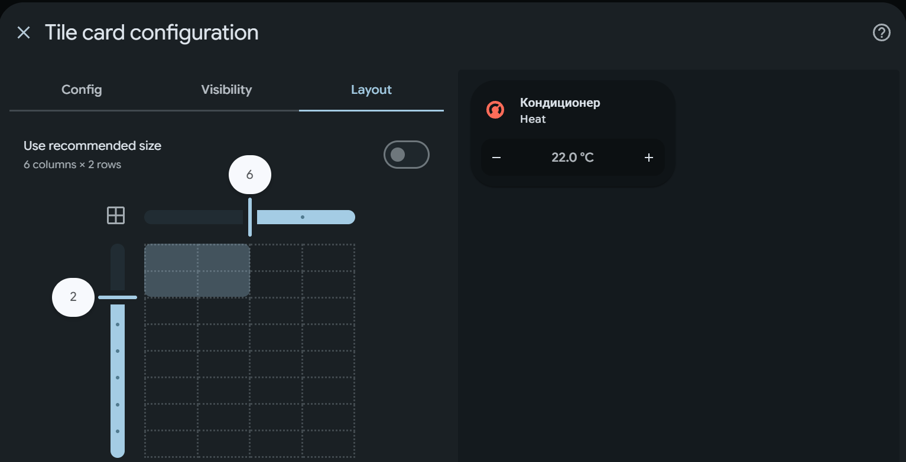
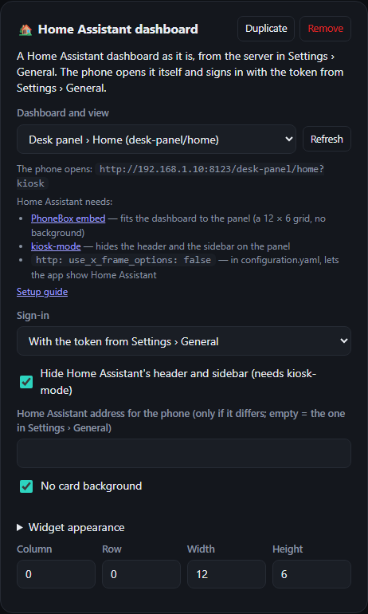

# PhoneBox embed for Home Assistant

**English** · [Русский](README.ru.md)

A dashboard module that fits a Home Assistant dashboard into the **Home Assistant dashboard** widget of
[PhoneBox](https://github.com/ersinkoc/phonebox), a desk panel on an old phone.



On a dashboard where it is turned on:

- **The panel's grid.** Cards are laid out on a 12 × 6 grid over the whole widget: a 6 × 2 card is exactly half the
  width and a third of the height. The editor on your computer uses the same grid, so the sizes you pick there are
  the ones the panel shows.
- **No background and no padding of its own** on the panel: the PhoneBox background shows through. Any theme works.

On your computer the dashboard keeps its header and background; only the panel shows it this way.

## Setup

### 1. Install

- **Home Assistant 2026.11 and later:** **Settings › Marketplace**, search for **PhoneBox embed** and install it. If
  it is not in the catalog yet: **⋮ › Add from link**, `https://github.com/dancho12/ha-phonebox-embed`, type
  **Dashboard** (this needs a GitHub account connected to the Marketplace).
- **Older versions:** the same through HACS (**⋮ › Custom repositories** for the link).

Install [kiosk-mode](https://github.com/NemesisRE/kiosk-mode) the same way: PhoneBox uses it to hide Home Assistant's
header and sidebar on the panel. Then reload the page with Ctrl+Shift+R.

### 2. Let Home Assistant be shown in an app

Add to `configuration.yaml` and restart Home Assistant:

```yaml
http:
  use_x_frame_options: false
```

Without it Home Assistant refuses to be shown inside another app, and the widget stays empty.

### 3. A dashboard for the panel

1. **Settings › Dashboards › Add dashboard › New dashboard from scratch**, for example "PhoneBox".
2. Press the pencil, then the pencil next to the view's name: type **Sections**, **Max number of section columns**
   **1**. Keep one section and put your cards in it.
3. **⋮ › Raw configuration editor**, and at the very end, at the top level:

   ```yaml
   phonebox:
     columns: 12
     rows: 6
   ```

4. Size each card on the **Layout** tab of its settings, in panel cells. For example a media player 6 × 2,
   two sensors 3 × 2, lights 6 × 2: three such rows fill the panel.



Keep **one section column** and one section per view. With wider sections Home Assistant's editor counts its own grid
(24 columns for two) while the panel shows 12, and sizes in the editor go wrong. A view can have numbers of its own:
`views: { climate: { rows: 4 } }` under `phonebox:` (the view's path or index).

### 4. PhoneBox

1. **Settings › General › Home Assistant**: the address and a long-lived access token (in Home Assistant: your
   profile › **Security**). The phone signs in with this token, the way Home Assistant's own app does: no password on
   the phone, no trusted networks.
2. Add the **Home Assistant dashboard** widget to a page (usually the whole page) and pick the dashboard in its
   settings. Under the list, **The phone opens** shows the exact address.



The dashboard then runs as the token's user. For a panel others can reach, make a Home Assistant user without
administrator rights, choose **Sign-in › Home Assistant's own sign-in** in the widget and sign in once on the phone.

## Troubleshooting

| What you see | What to do |
|---|---|
| An empty widget | Step 2, then restart Home Assistant |
| Home Assistant's sign-in page | The token in PhoneBox › Settings › General, and **Sign-in: With the token** in the widget |
| "Home Assistant does not answer" | Check **The phone opens** in the widget's settings and that the phone is on the same network |
| The usual grid, a background, a header | The module or kiosk-mode is not loaded: reload Home Assistant with Ctrl+Shift+R. The browser console shows a `PHONEBOX-EMBED` line when the module is there |
| Card sizes in the editor do not match the panel | Step 3.2: one section column, a section one column wide |

## How it works

The module computes nothing in JavaScript; it only sets Home Assistant's own CSS variables: the section grid's column
count (`--base-column-count`), the row height inside the frame (`(100vh − gaps) / rows`), and transparent backgrounds
of the page and the view. The styles go into the shadow DOM of Home Assistant's components while such a dashboard is
open; other dashboards are left alone.

MIT license.
