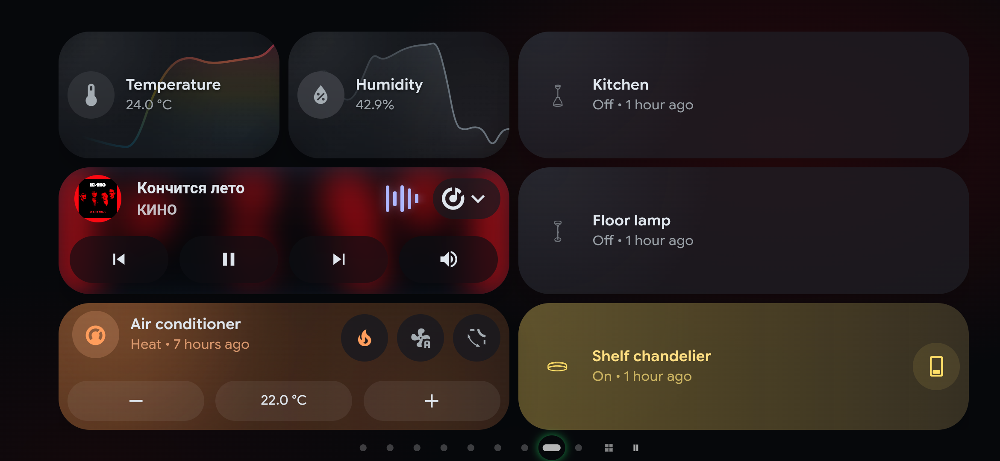
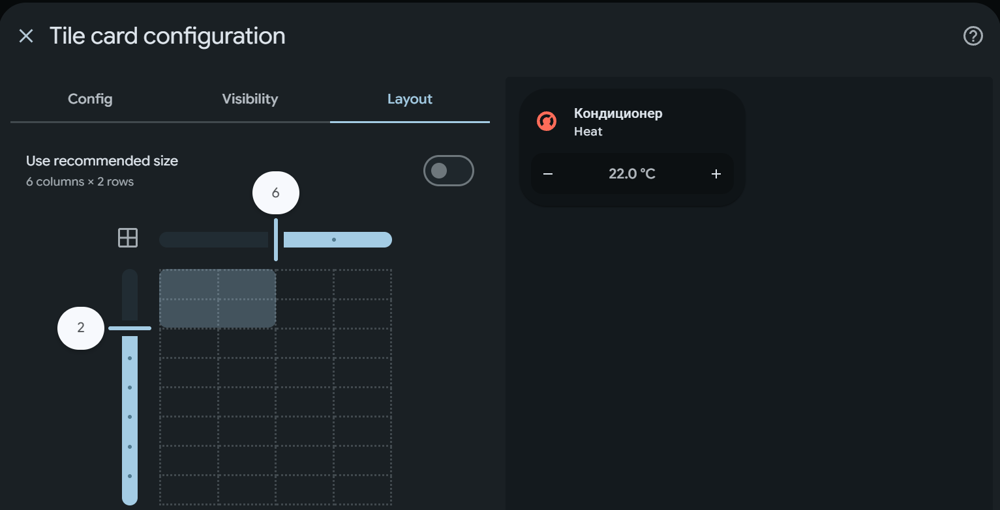
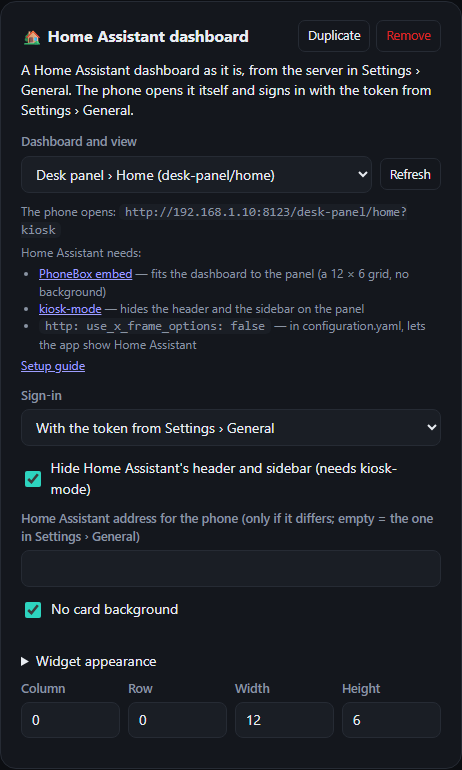

# PhoneBox embed для Home Assistant

[English](README.md) · **Русский**

Модуль дашборда: подгоняет дашборд Home Assistant под виджет **Дашборд Home Assistant** в
[PhoneBox](https://github.com/ersinkoc/phonebox), настольной панели из старого телефона.



На дашборде, где модуль включён:

- **Сетка панели.** Карточки раскладываются по сетке 12 × 6 на весь виджет: карточка 6 × 2 — ровно половина ширины и
  треть высоты. Редактор на компьютере использует ту же сетку, так что размеры, выбранные там, и будут на панели.
- **Без своего фона и отступов** на панели: сквозь дашборд виден фон PhoneBox. Подходит любая тема.

На компьютере у дашборда остаются шапка и фон, только панель показывает его так.

## Настройка

### 1. Установка

- **Home Assistant 2026.11 и новее:** **Настройки › Маркетплейс**, найдите **PhoneBox embed** и установите. Если его
  ещё нет в каталоге: **⋮ › Добавить по ссылке**, `https://github.com/dancho12/ha-phonebox-embed`, тип **Dashboard**
  (для этого к Маркетплейсу нужно подключить GitHub).
- **Более старые версии:** то же через HACS (ссылка — через **⋮ › Пользовательские репозитории**).

Так же установите [kiosk-mode](https://github.com/NemesisRE/kiosk-mode): PhoneBox с его помощью прячет шапку и
боковую панель Home Assistant на панели. Потом обновите страницу через Ctrl+Shift+R.

### 2. Разрешить показ Home Assistant в приложении

Добавьте в `configuration.yaml` и перезапустите Home Assistant:

```yaml
http:
  use_x_frame_options: false
```

Без этого Home Assistant не даёт показывать себя внутри другого приложения, и виджет остаётся пустым.

### 3. Дашборд для панели

1. **Настройки › Панели › Добавить панель › Новая панель с нуля**, например «PhoneBox».
2. Карандаш, затем карандаш у названия вида: тип **Разделы**, **Максимальное число столбцов разделов** — **1**.
   Оставьте один раздел и кладите карточки в него.
3. **⋮ › Редактор YAML** и в самом конце, без отступа:

   ```yaml
   phonebox:
     columns: 12
     rows: 6
   ```

4. Размер каждой карточки задайте на вкладке **Расположение** в её настройках, в клетках панели. Например, плеер
   6 × 2, два датчика 3 × 2, свет 6 × 2: три таких ряда заполняют панель.



Оставляйте **один столбец разделов** и один раздел на вид. С более широкими разделами редактор Home Assistant считает
свою сетку (24 столбца на два), а панель показывает 12, и размеры в редакторе путаются. Свои числа для отдельного вида:
`views: { climate: { rows: 4 } }` под `phonebox:` (путь вида или его номер).

### 4. PhoneBox

1. **Настройки › Общие › Home Assistant**: адрес и долгосрочный токен доступа (в Home Assistant: ваш профиль ›
   **Безопасность**). Телефон входит по этому токену, как официальное приложение Home Assistant: без пароля на
   телефоне и без доверенных сетей.
2. Добавьте на страницу виджет **Дашборд Home Assistant** (обычно на всю страницу) и выберите дашборд в его
   настройках. Строка **Телефон откроет** под списком показывает точный адрес.



Дашборд работает от имени владельца токена. Если к панели есть доступ у других, заведите в Home Assistant
пользователя без прав администратора, в виджете выберите **Вход › Вход Home Assistant** и один раз войдите на телефоне.

## Если что-то не так

| Что видно | Что сделать |
|---|---|
| Пустой виджет | Шаг 2, затем перезапуск Home Assistant |
| Страница входа Home Assistant | Токен в PhoneBox › Настройки › Общие и **Вход: по токену** в виджете |
| «Home Assistant не отвечает» | Проверьте строку **Телефон откроет** в настройках виджета и что телефон в той же сети |
| Обычная сетка, фон, шапка | Модуль или kiosk-mode не загружен: обновите Home Assistant через Ctrl+Shift+R. В консоли браузера модуль пишет строку `PHONEBOX-EMBED` |
| Размеры в редакторе не совпадают с панелью | Шаг 3.2: один столбец разделов, раздел шириной в один столбец |

## Как это работает

Модуль ничего не вычисляет в JavaScript, он только задаёт CSS-переменные самого Home Assistant: число столбцов сетки
раздела (`--base-column-count`), высоту строки внутри рамки (`(100vh − промежутки) / rows`) и прозрачный фон страницы и
вида. Стили попадают в shadow DOM компонентов Home Assistant, пока открыт такой дашборд; другие дашборды он не трогает.

Лицензия MIT.
